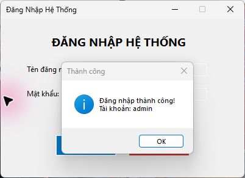

# 🔐 Bài Tập 5.1 – Nâng cấp Form Đăng Nhập (Bài 4.1)

Nâng cấp Form đăng nhập Windows Forms C# bằng cơ sở dữ liệu SQLite.

---

## 📋 Mô tả

Form đăng nhập với đầy đủ các tính năng:
- Kiểm tra dữ liệu nhập bằng **ErrorProvider** (không để trống)
- Xác thực tên đăng nhập và mật khẩu từ **CSDL SQLite**; từ chối tài khoản không tồn tại hoặc mật khẩu sai
- Lưu mật khẩu bằng **PBKDF2-SHA256**, salt ngẫu nhiên và 600.000 vòng lặp
- Ẩn/hiện mật khẩu bằng **CheckBox**
- Phím **Enter** → kích hoạt nút Đăng Nhập
- Phím **Esc** → thoát ứng dụng

---

## 🖼️ Giao diện



---

## ⚙️ Các thành phần chính

| Tên Control | Chức năng |
|-------------|-----------|
| `txtUsername` | Ô nhập tên đăng nhập |
| `txtPassword` | Ô nhập mật khẩu (ẩn `***` mặc định) |
| `chkShowPassword` | Tick để hiện mật khẩu, bỏ tick để ẩn |
| `btnLogin` | Nút đăng nhập — gán `AcceptButton` (phím Enter) |
| `btnExit` | Nút thoát — gán `CancelButton` (phím Esc) |
| `errorProvider` | Hiển thị lỗi khi bỏ trống username hoặc password |

---

## 🚀 Cách chạy

**Bằng Visual Studio:**
1. Mở file `BT5_1_LoginForm.slnx` bằng Visual Studio 2026, có workload **.NET desktop development**
2. Nhấn `F5` để chạy

**Bằng terminal:**
```bash
dotnet run
```

---

## 🛠️ Yêu cầu
- .NET 10.0 SDK
- Windows OS
- Visual Studio 2026 (18.0 trở lên) nếu chạy bằng IDE
- NuGet `Microsoft.Data.Sqlite` (được restore khi build)

## 🗄️ Cơ sở dữ liệu

- Tự tạo bảng `Users` từ [Database/Schema.sql](Database/Schema.sql) khi mở ứng dụng lần đầu.
- File mặc định: `%LOCALAPPDATA%\LTNET\BT51-LoginForm\login.db`.
- Tài khoản thực hành: **`admin` / `Admin@123`**. Khởi tạo lại không ghi đè mật khẩu đã có trong CSDL.
- Dữ liệu được giữ lại sau khi đóng/mở ứng dụng; không cần cài dịch vụ SQL Server để chạy bản SQLite này.
- Truy vấn dùng tham số; file CSDL và `bin/obj/.vs` không đẩy lên GitHub.
- Có thể đặt biến môi trường `BT51_DATABASE_PATH` để chọn đường dẫn file CSDL khác.

## 🔗 Repository

- [Bài 5.1 – nâng cấp Bài 4.1](https://github.com/phmthnh/BT5.1-LoginForm)
- [Bài 5.2 – nâng cấp Bài 4.2](https://github.com/phmthnh/BT5.2-StudentRegistration)
